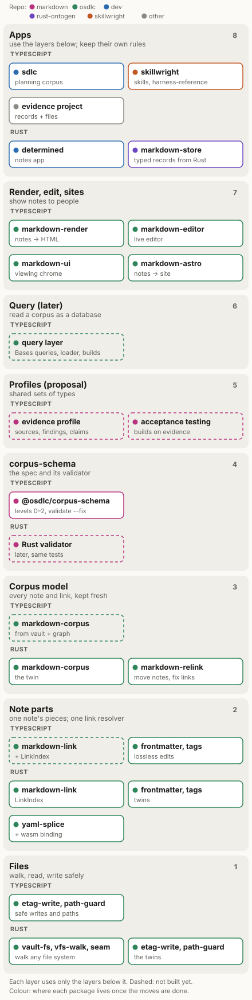
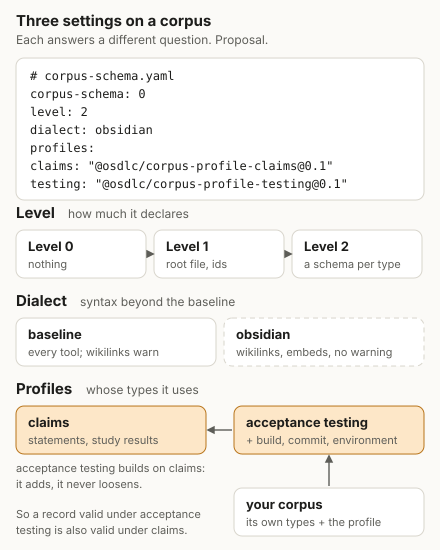

# The markdown ecosystem architecture

This is what we are building toward. The [plan](ecosystem-plan.md) says where we are today and the
order of the work. This page says what the finished shape looks like. It is a draft, and some parts
are still proposals. Those are marked.

## What it is for

We keep a lot of knowledge as Markdown notes: planning docs, skills, research, evidence. People read
and edit these notes in Obsidian or a text editor, and programs read them as data. The ecosystem is
the set of packages that lets programs do that safely, without breaking what people wrote.

## Words

- A **note** is a Markdown file, often with YAML frontmatter at the top.
- A **corpus** is a folder of notes and the files they link to. An Obsidian vault is a corpus, and so
  is a docs folder. This is decided: we say corpus, not vault.
- **corpus-schema** is the spec for what a corpus can declare about itself: its types, ids and
  schemas. This name is decided.
- A **record** is one note (or YAML or JSON file) that holds data of one type.
- A **twin** is a TypeScript package and a Rust package that do the same job and pass the same tests.

## The layers



The diagram shows the top layer first. Each layer uses only the layers below it. Here they are
from the bottom up.

### 1. Files

Walking folders, reading files and writing them safely.

- It owns: the folder walk and its rules (which folders to skip, hidden files, symlinks), safe paths,
  and atomic writes that refuse to overwrite a file someone else changed.
- It does not know what Markdown is.
- Packages: etag-write and path-guard (TypeScript and Rust); markdown-vault-fs, vfs-walk and
  vfs-seam (Rust). vfs-seam lets the same Rust code run on a real disk, in memory or in a browser.

### 2. Note parts

The pieces of one note.

- It owns: finding links and resolving them to files, splitting frontmatter from the body and
  writing it back byte for byte, inline tags, tables, and checking one document's structure.
- It does not know about other notes, except through the link index it is given.
- Packages, all twins: markdown-link, frontmatter-lossless, yaml-splice, markdown-tags,
  markdown-contract, and gfm-table (TypeScript) with gfm-pipe-table (Rust).
- Target: TypeScript markdown-link gets the same link resolver as the Rust one, called `LinkIndex`.
  Then it is the only place in each language that decides what a link points to.

### 3. The corpus model

Every note in a corpus at once.

- It owns: the list of files and notes, each note's links in both directions (what it links to and
  what links to it), frontmatter, tags, and keeping all of that up to date as files change.
- It does not know about types or schemas, and it never rejects a note. A note with broken
  frontmatter is read as body only.
- Today: markdown-corpus (Rust, osdlc) does this. In TypeScript the same job is split between
  markdown-vault and vault-graph-core in dev, and they resolve links in two different ways.
- Target: one TypeScript package called markdown-corpus, made from those two, the twin of the Rust
  crate. The crate keeps its name. This is decided.

### 4. corpus-schema

The spec, and the validator that checks a corpus against it.

- It owns: the root file `corpus-schema.md` (or `.yaml` or `.json`) that marks a corpus, type folders,
  record ids, folder records, JSON Schemas for types, links between types (`x-ref`), and the
  `validate` and `validate --fix` commands.
- It does not walk folders or resolve links itself. It reads the corpus model. (Today the validator
  still does its own walk. That changes in the plan.)
- A folder record is a folder that holds a note with the folder's own name. That note is the record,
  and it owns every other file in the folder. A test run keeps its script, query and results this
  way. Folder records are part of level 1 and ship in 0.1.0. This is decided.
- Packages: `@osdlc/corpus-schema` (TypeScript), in
  [osdlc/osdlc#725](https://github.com/osdlc/osdlc/pull/725), which is being renamed from
  markdown-db. A Rust validator comes later and runs the same tests.

### 5. Profiles (proposal)

Shared sets of types.

- A profile is a versioned set of types and rules that many corpora can use. A corpus can use more
  than one, next to its own types.
- The first one is the evidence profile: sources, findings and claims, from the work in
  [osdlc/skillwright#74](https://github.com/osdlc/skillwright/pull/74). Until profiles work, a corpus
  copies those schemas in as plain files.
- dev's model-schema already does most of this. It calls a profile a "pack": a folder of YAML that
  declares kinds, can require and extend other packs, and compiles to JSON Schema. See
  [sksizer/dev#4069](https://github.com/sksizer/dev/pull/4069) and
  [sksizer/dev#4070](https://github.com/sksizer/dev/pull/4070). We'd rather use the word profile,
  because that is the usual word in data standards and "pack" already means something else in dev.
- A profile can build on other profiles. It names the profiles it builds on and adds types or fields
  to theirs. It never removes or loosens a rule from the profile below. So a record that is valid
  under the child is also valid under the parent. VA-Spec, FHIR and dev's packs (`requires` and
  `extend`) already work this way.
- Example: an acceptance-testing profile built on the evidence profile. An acceptance criterion is
  the question a claim answers. A test is a method. A test run is a finding. Pass or fail is whether
  the finding supports or disputes the claim. The testing profile adds fields like build, commit and
  environment. It can let a folder use testing words, such as `evidence/` for findings, while the
  field names stay the same as in the evidence profile.

### 6. Query (later)

Reading a corpus as a database.

- It owns: loading records into memory, queries, and building other forms from them, such as JSON or
  SQLite files.
- It reads the corpus model and corpus-schema. It does not have its own file walk or link rules.
- Today: markdown-vault-query (dev) runs Obsidian Bases queries over a vault. Target: it moves to
  osdlc on top of the corpus model, and becomes the one query layer. We keep the word "db" for this
  layer.

### 7. Render, edit, sites

Showing notes to people.

- It owns: turning notes into HTML, the live editor, viewing chrome, and building sites.
- Packages: markdown-render, markdown-editor, markdown-ui and markdown-astro. They live in dev today
  and move to osdlc ([osdlc/osdlc#720](https://github.com/osdlc/osdlc/pull/720) and
  [osdlc/osdlc#719](https://github.com/osdlc/osdlc/pull/719) are open).

### 8. Apps

sdlc, skillwright, harness-reference, determined, and the evidence project. They use the layers
below and keep only app-specific rules. markdown-store and ontogen in rust-ontogen also sit here:
they write typed records from Rust code. In the target they write the corpus-schema layout and use
the shared note parts.

## Three settings on a corpus (proposal)



A corpus says three separate things about itself in its root file:

```yaml
# corpus-schema.md
level: 2
dialect: obsidian
profiles: [acceptance-testing@0]
```

- The **level** says how much the corpus declares. Level 0 declares nothing: any folder of linked
  notes. Level 1 adds the root file, type folders, ids and folder records. Level 2 gives each type a
  JSON Schema.
- The **dialect** says which syntax it uses beyond the baseline. The baseline is what every tool
  supports, such as relative Markdown links. A dialect like `obsidian` adds wikilinks that resolve
  anywhere in the vault, and embeds. A tool that knows the dialect checks it. A tool that doesn't
  checks the baseline and says what it skipped. There is no promise that every tool handles every
  dialect.
- The **profiles** say whose types it uses. A corpus that uses the acceptance-testing profile also
  gets the evidence profile it builds on.

These are separate on purpose. A profile is not a higher level, and a dialect is not a profile.

## Twins and shared tests

When a job has a TypeScript and a Rust package, they share one set of test cases, so they behave the
same. osdlc keeps these cases in `packages/conformance/<name>/`, as its conformance-suites standard
describes. Each folder has a README, a SPEC.md when there is a format to state, and the cases. Every
implementation runs them.

- Already there: frontmatter-lossless, config-layers, intersect, path-guard, tiered-dirs, and the
  corpus-schema spec (TypeScript only for now).
- Planned: markdown-link (with the resolver), markdown-corpus, markdown-tags, markdown-contract and
  gfm-table, whose cases still live inside their packages.

A twin can have extras the other doesn't need. It just has to pass the shared cases.

## Rules between layers

- Each layer uses only the layers below it.
- There is one link resolver in each language, in markdown-link. Nothing else decides what a link
  points to.
- Writes never lose what a person wrote. Frontmatter is rewritten with frontmatter-lossless or
  yaml-splice, and files are saved with etag-write.
- General code lives in osdlc. Apps use it from there and keep only their own rules.

## Where things live

| Job | Today | Target |
|---|---|---|
| Note parts | osdlc (markdown-tags in dev, moving) | osdlc |
| Corpus model, TypeScript | markdown-vault and vault-graph-core in dev | markdown-corpus in osdlc |
| Corpus model, Rust | markdown-corpus in osdlc | the same |
| corpus-schema | open PR in osdlc; a copy in skillwright | osdlc, on npm |
| Profiles | model-schema and packs in dev (open PRs) | osdlc |
| Query | markdown-vault-query in dev | osdlc |
| Render, edit, sites | dev | osdlc |
| Typed records from Rust | markdown-store in rust-ontogen | stays there, on the shared parts |

The order of the moves is in the [plan](ecosystem-plan.md#how-we-get-there).

## Open questions

- Do we adopt the three settings, and the word profile?
- How does a profile let a folder use its own words (like `evidence/`) without renaming fields?
- Is a profile written as YAML (like model-schema packs) or as plain JSON Schema files, or can it be
  either?
- What exactly is in the baseline, and what goes in the obsidian dialect?
- Does markdown-store stay in rust-ontogen, or move to osdlc?
- When does the query layer start, and what does it build first?
