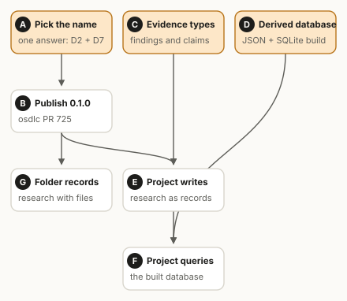
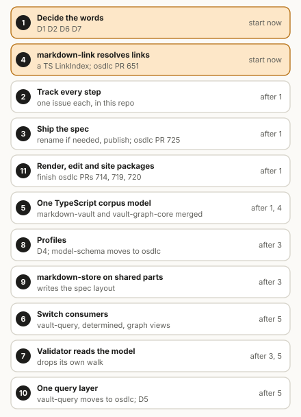

# The markdown ecosystem plan

This is a working plan. It says where our markdown packages are today, what is wrong with them,
where we want to end up, and the steps to get there. We update it as we go.

## Words we use

- A **note** is a Markdown file, often with YAML frontmatter at the top.
- A **corpus** is a folder of notes and the files they link to. An Obsidian vault is a corpus. So
  is a docs folder. Some of our packages say "vault" for the same thing.
- **The spec** is the format we are writing for typed records kept as notes. Today it is called
  markdown-db. Its name is still open (see the decisions below).
- A **level** says how much a corpus declares about itself. Level 0 declares nothing. Level 1 adds
  a root file, type folders and ids. Level 2 gives each type a JSON Schema.
- A **profile** is a shared set of types that many corpora can use, such as a set of types for
  evidence. A corpus can use more than one profile, next to its own types.
- A **dialect** is a named flavor of note syntax on top of a common baseline, such as Obsidian's
  wikilinks and embeds.
- **Conformance cases** are shared test inputs and expected results. Every implementation of the
  spec, in any language, runs the same cases.

## First: unlock the evidence project

Another project is waiting on one thing. It needs a format for keeping evidence and research as
structured records, and a database built from those records. Most of this exists already, so this
comes before the rest of the plan.

- **Pick the name.** This is the only thing that blocks publishing. We can publish as markdown-db
  now and rename before 1.0, or choose the final name now and rename the open PR first, which is
  about an hour of work.
- **Publish 0.1.0.** The package and the spec are in
  [osdlc/osdlc#725](https://github.com/osdlc/osdlc/pull/725). It has been reviewed and fixed. The
  owner merges it and the release script publishes it.
- **Evidence types.** The project copies in plain JSON Schema files for its types: sources, findings
  (one observation of a source, with its date, quote and location) and claims (a statement that
  cites findings as support or as dispute). They come from the harness-reference corpus in
  [osdlc/skillwright#74](https://github.com/osdlc/skillwright/pull/74). Copying them means we don't
  need profiles to work yet. Later the same files become the evidence profile.
- **A derived database.** A `build` command that checks the corpus, then writes every valid record
  to one JSON file per type and to a SQLite file with one table per type. This is small, because
  the validator already returns every valid record by type.
- **Folder records.** Only needed if the research includes files, such as scripts, queries or CSV
  results. A folder that holds a note with the folder's own name is one record, and it owns the
  other files in it. We have agreed to add this but have not built it.

skillwright uses a copy of the package today: harness-reference depends on it as
`workspace:*`. Once the package is on npm, skillwright switches to it and deletes the copy.

## Where we are today

| Layer | TypeScript | Rust |
|---|---|---|
| Render, edit, sites | markdown-render, markdown-editor, markdown-ui, markdown-astro (all in dev) | none |
| Query and store | markdown-vault-query (dev) | markdown-store, ontogen (rust-ontogen) |
| Types | model-schema and its packs (dev); markdown-db (osdlc, not published) | none |
| Corpus model | markdown-vault, vault-graph-core (dev) | markdown-corpus, markdown-relink (osdlc) |
| Note parts | markdown-link, frontmatter-lossless, markdown-contract, gfm-table, yaml-splice (osdlc); markdown-tags (dev) | a twin of each |
| Files | etag-write, path-guard (osdlc) | markdown-vault-fs, vfs-walk, vfs-seam, etag-write (osdlc) |

Some of these are moving into osdlc already: markdown-tags in
[osdlc/osdlc#714](https://github.com/osdlc/osdlc/pull/714), markdown-astro in
[#719](https://github.com/osdlc/osdlc/pull/719) and markdown-render in
[#720](https://github.com/osdlc/osdlc/pull/720). The pack harness is in
[sksizer/dev#4069](https://github.com/sksizer/dev/pull/4069) and the first packs in
[sksizer/dev#4070](https://github.com/sksizer/dev/pull/4070).

The note-part packages and the Rust corpus packages are published on npm and crates.io. Nothing
from dev or rust-ontogen is published, and neither is markdown-db.

## What is wrong

The biggest problem is that four pieces of code each decide what a link points to, and they don't
use the same rules.

| Id | Problem | Where |
|---|---|---|
| F1 | Two pieces of TypeScript decide links differently | markdown-vault has its own rule; vault-graph-core copies the Rust one |
| F2 | TypeScript markdown-link can't resolve links | only the Rust crate can, so each TS package wrote its own |
| F3 | markdown-link misses some links | titles and brackets in paths: [osdlc/osdlc#635](https://github.com/osdlc/osdlc/issues/635), fix in [#651](https://github.com/osdlc/osdlc/pull/651) |
| F4 | One thing, two words | TS says vault, Rust says corpus, and the spec uses corpus for something narrower |
| F5 | Two ways to define types | packs in model-schema, and schema files in markdown-db |
| F6 | Two ways to lay out typed records | markdown-store and markdown-db use different folders and links |
| F7 | markdown-store parses notes itself | its own frontmatter and wikilink code |
| F8 | The validator walks the folder itself | it doesn't use the corpus model |
| F9 | Two query layers | markdown-vault-query exists; markdown-db plans another |
| F10 | markdown-db sounds like a database | it is a format and a checker, and other projects called MarkdownDB are real databases |
| F11 | Packages in the wrong place | `@osdlc` packages that live in dev; vault-graph-core is `@sdlc` |
| F12 | Agreed work went untracked | a planned rename of the markdown-corpus crate was never written down |

## Where we want to end up

We follow four rules:

1. One package per job per language.
2. When a job has a TypeScript and a Rust package, they are twins. They share one set of
   conformance cases, so they behave the same.
3. One word for each idea.
4. Anything general lives in osdlc. Apps use it from there.

In practice:

- TypeScript markdown-link learns to resolve links the same way the Rust one does. Then nothing
  else needs its own resolver.
- markdown-vault and vault-graph-core become one TypeScript corpus model, the twin of the Rust
  markdown-corpus crate.
- The spec has levels 0 to 2. Its validator reads the corpus model instead of walking the folder
  itself.
- Types can come from profiles. There is one format for defining types, not two.
- markdown-store writes the spec's layout and uses the shared note parts.
- There is one query layer, built on the corpus model.

Levels and profiles are separate ideas. A level says how much a corpus declares. A profile says
whose types it uses. So a profile is not "level 3": a corpus at level 2 can use the evidence profile,
the sdlc profile and its own types all at once.

### Proposal: a baseline and dialects

This is a proposal, not a decision.

The spec would have a baseline that every tool supports. On top of it, a corpus could name a
dialect for things that vary from tool to tool, with no promise that every tool handles them. For
example, a corpus that says `dialect: obsidian` may use wikilinks that resolve anywhere in the vault,
and embeds. A tool that knows the dialect checks it. A tool that doesn't checks only the baseline,
and says that it did.

We already use the word this way. markdown-tags has three dialects, and markdown-render renders the
Obsidian dialect. It works like CommonMark as the baseline with GFM as an extension.

So the spec would have three separate settings:

- the **level**: how much a corpus declares, from 0 to 2;
- the **dialect**: which link and syntax flavor it uses beyond the baseline;
- the **profiles**: which shared sets of types it uses.

We'd like to call these shared sets of types **profiles**, not packs. Profile is the usual word in
data standards: FHIR profiles, Dublin Core application profiles, the W3C Profiles Vocabulary and the
`profile` link relation in [RFC 6906](https://www.rfc-editor.org/rfc/rfc6906), and GA4GH VA-Spec
profiles. In dev, "pack" already means plugin bundles (glossary term TM-0050). Whether model-schema
switches its word is an open question for
[sksizer/dev#4069](https://github.com/sksizer/dev/pull/4069).

## Decisions we need

The first four block everything else.

- **D1. One word for a folder of notes.** Corpus, which osdlc uses today, or vault.
- **D2. The spec's name.** See the ideas below.
- **D6. Does the spec have a level 0?** If yes, any Obsidian vault already conforms.
- **D7. Do we publish before the name is settled?** Hold, or publish as markdown-db and rename
  before 1.0.

Then:

- **D3. The TypeScript corpus model's name.** It should match its Rust twin, so it follows D1 and D2.
- **D4. How types are defined.** Profiles written as packs, or plain JSON Schema files that packs
  compile to.
- **D5. What "db" means.** The query layer, or nothing until we build one.

### Name ideas for the spec

These are ideas, not decisions.

- **corpus-schema.** Says what the spec adds: a schema on top of a corpus. The command would be
  `corpus-schema validate` and the root file `corpus-schema.md`. It keeps "corpus" as the word for
  a plain folder of notes, so the markdown-corpus crate keeps its name. It sits well next to
  model-schema. A level-0 corpus simply has no schema file. This is the idea we like best so far.
- **corpus-spec.** Names the document more than the tool. `corpus-spec validate` reads a bit oddly.
- **corpora-spec.** Like corpus-spec, but plural, which is easy to mistype.
- **markdown-corpus.** Fits every level, but the Rust crate already has the name.
- **markdown-records.** Fits levels 1 and 2 only.
- **markdown-db.** What we use today. It sounds like a database, and other projects with that name
  are databases. Better kept for a query layer.

All of these are free on npm and crates.io except markdown-corpus, which is our own crate.

## How we get there

1. **Decide the words.** D1, D2, D6 and D7, written down here. We rename nothing before this.
2. **Track every step.** One issue per step, in this repo.
3. **Ship the spec.** Rename [osdlc/osdlc#725](https://github.com/osdlc/osdlc/pull/725) if D2
   changes the name, then merge and publish 0.1.0.
4. **Teach markdown-link to resolve links.** Land
   [osdlc/osdlc#651](https://github.com/osdlc/osdlc/pull/651), then add a TypeScript resolver taken
   from vault-graph-core's copy of the Rust one, with shared cases. This can start now.
5. **Make one TypeScript corpus model.** Merge markdown-vault and vault-graph-core into osdlc on top
   of markdown-link's resolver. Needs steps 1 and 4.
6. **Switch the users** of those two packages: markdown-vault-query, determined and the graph views
   in sdlc. Needs step 5.
7. **Let the validator read the corpus model.** Needs steps 3 and 5.
8. **Add profiles.** Decide D4, then let a corpus take its level-2 types from profiles. model-schema
   moves to osdlc. Needs step 3 and [sksizer/dev#4069](https://github.com/sksizer/dev/pull/4069).
9. **Put markdown-store on the shared parts** and have it write the spec's layout. Needs step 3.
10. **Make one query layer.** Move markdown-vault-query to osdlc on top of the corpus model; the
    database build lives there too. Needs step 5 and D5.
11. **Finish moving the render, edit and site packages**:
    [osdlc/osdlc#714](https://github.com/osdlc/osdlc/pull/714),
    [#719](https://github.com/osdlc/osdlc/pull/719),
    [#720](https://github.com/osdlc/osdlc/pull/720), then markdown-editor and markdown-ui. Rename
    the vault words to match D1. Needs step 1.

Steps 3 and 4 can run side by side. So can steps 8, 9 and 10 once their inputs are done.
