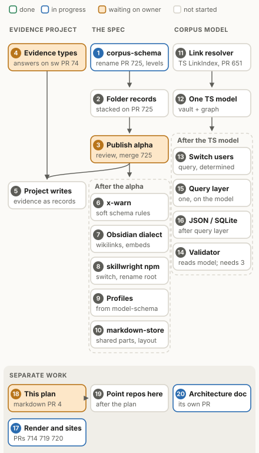
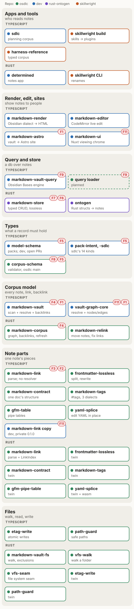
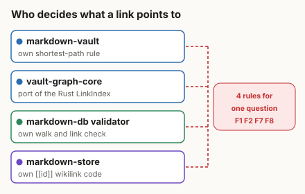
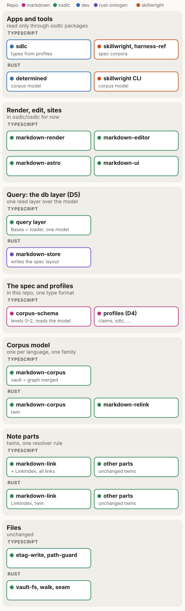
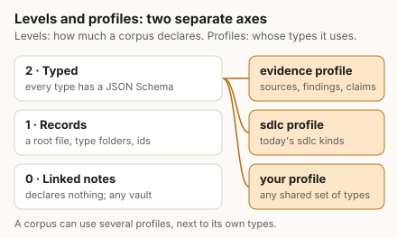

# The markdown ecosystem plan

This is a working plan. It says where our markdown packages are today, what is wrong with them,
where we want to end up, and the steps to get there. We update it as we go.

## Words we use

- A **note** is a Markdown file, often with YAML frontmatter at the top.
- A **corpus** is a folder of notes and the files they link to. An Obsidian vault is a corpus. So
  is a docs folder. Some of our packages say "vault" for the same thing.
- **The spec** is the format we are writing for typed records kept as notes. It is called
  **corpus-schema** (decided 2026-11-08). The open PR still calls it markdown-db until the rename
  lands.
- A **level** says how much a corpus declares about itself. Level 0 declares nothing. Level 1 adds
  a root file, type folders and ids. Level 2 gives each type a JSON Schema.
- A **profile** is a shared set of types that many corpora can use, such as a set of types for
  evidence. A corpus can use more than one profile, next to its own types.
- A **dialect** is a named flavor of note syntax on top of a common baseline, such as Obsidian's
  wikilinks and embeds.
- **Conformance cases** are shared test inputs and expected results. Every implementation of the
  spec, in any language, runs the same cases.

## The work

This graph shows all the work we know about. The numbers match the list in
[All the work](#all-the-work) below. An arrow means "must come first". A dashed box means every task
in it waits on the task whose arrow points at the box.

## First: unlock the evidence project

Another project is waiting on one thing. It needs a format for keeping evidence and research as
structured records. It will collect evidence, observations and test material, such as scripts,
queries and CSV results, as records with their files. Most of this exists already, so this comes
before the rest of the plan. It is tasks 1 to 5 in the graph.

1. **Rename to corpus-schema.** The package and spec in
   [osdlc/osdlc#725](https://github.com/osdlc/osdlc/pull/725) become `@osdlc/corpus-schema`, with
   the command `corpus-schema` and the root file `corpus-schema.md` (or `.yaml`, `.json`). The spec
   text gains the levels. This is done and reviewed, and waits on the owner to merge.
2. **Folder records.** A folder that holds a note with the folder's own name is one record, and it
   owns the other files in it. This is how a test run keeps its script, its query and its CSV results
   together. It goes into the first release:
   [osdlc/osdlc#729](https://github.com/osdlc/osdlc/pull/729), stacked on #725. It is reviewed and
   waits on the owner to merge.
3. **Publish 0.1.0-alpha.** The owner reviews and merges #725 and the release script publishes it.
4. **Evidence types.** The project copies in plain JSON Schema files for its types: sources, findings
   (one observation of a source, with its date, quote and location) and claims (a statement that
   cites findings as support or as dispute). They come from the harness-reference corpus in
   [osdlc/skillwright#74](https://github.com/osdlc/skillwright/pull/74), which needs the owner's
   answers on its naming questions. Copying them means we don't need profiles to work yet. Later the
   same files become the evidence profile.
5. **The project writes records.** It starts keeping its evidence as records, checked by the
   validator.

A database built from the records (JSON or SQLite) is not in the fast path. It is task 16, after
the query layer (task 15).

## Where we are today

| Layer | TypeScript | Rust |
|---|---|---|
| Render, edit, sites | markdown-render, markdown-editor, markdown-ui, markdown-astro (all in dev) | none |
| Query and store | markdown-vault-query (dev) | markdown-store, ontogen (rust-ontogen) |
| Types | model-schema and its packs (dev); markdown-db (osdlc, not published) | none |
| Corpus model | markdown-vault, vault-graph-core (dev) | markdown-corpus, markdown-relink (osdlc) |
| Note parts | markdown-link, frontmatter-lossless, markdown-contract, gfm-table, yaml-splice (osdlc); markdown-tags (dev) | a twin of each |
| Files | etag-write, path-guard (osdlc) | markdown-vault-fs, vfs-walk, vfs-seam, etag-write, path-guard (osdlc) |

Some of these are moving into osdlc already: markdown-tags in
[osdlc/osdlc#714](https://github.com/osdlc/osdlc/pull/714), markdown-astro in
[#719](https://github.com/osdlc/osdlc/pull/719) and markdown-render in
[#720](https://github.com/osdlc/osdlc/pull/720). The pack harness is in
[sksizer/dev#4069](https://github.com/sksizer/dev/pull/4069) and the first packs in
[sksizer/dev#4070](https://github.com/sksizer/dev/pull/4070).

The osdlc note-part packages and the Rust corpus packages are published on npm and crates.io. Nothing
from dev or rust-ontogen is published, and neither is markdown-db.

## What is wrong

The biggest problem is that four pieces of code each decide what a link points to, and they don't
use the same rules.

| Id | Problem | Where |
|---|---|---|
| F1 | Two pieces of TypeScript decide links differently | markdown-vault has its own rule; vault-graph-core copies the Rust one |
| F2 | TypeScript markdown-link can't resolve links | only the Rust crate can, so each TS package wrote its own |
| F3 | markdown-link misses some links | titles and brackets in paths: [osdlc/osdlc#635](https://github.com/osdlc/osdlc/issues/635), fix in [#651](https://github.com/osdlc/osdlc/pull/651) |
| F4 | One thing, two words | TS says vault, Rust says corpus, and the spec uses corpus for something narrower |
| F5 | Two ways to define types | packs in model-schema, and schema files in markdown-db |
| F6 | Two ways to lay out typed records | markdown-store and markdown-db use different folders and links |
| F7 | markdown-store parses notes itself | its own frontmatter and wikilink code |
| F8 | The validator walks the folder itself | it doesn't use the corpus model |
| F9 | Two query layers | markdown-vault-query exists; markdown-db plans another |
| F10 | markdown-db sounds like a database | it is a format and a checker; the rename to corpus-schema (task 1) fixes this |
| F11 | Packages in the wrong place | `@osdlc` packages that live in dev; vault-graph-core is `@sdlc` |
| F12 | Agreed work went untracked | a planned rename of the markdown-corpus crate was never written down |

## Where we want to end up

We follow four rules:

1. One package per job per language.
2. When a job has a TypeScript and a Rust package, they are twins. They share one set of
   conformance cases, so they behave the same.
3. One word for each idea.
4. Anything general lives in osdlc. Apps use it from there.

In practice:

- TypeScript markdown-link learns to resolve links the same way the Rust one does. Then nothing
  else needs its own resolver.
- markdown-vault and vault-graph-core become one TypeScript corpus model, the twin of the Rust
  markdown-corpus crate.
- The spec has levels 0 to 2. Its validator reads the corpus model instead of walking the folder
  itself.
- Types can come from profiles. There is one format for defining types, not two.
- markdown-store writes the spec's layout and uses the shared note parts.
- There is one query layer, built on the corpus model.

Levels and profiles are separate ideas. A level says how much a corpus declares. A profile says
whose types it uses. So a profile is not "level 3": a corpus at level 2 can use the evidence profile,
the sdlc profile and its own types all at once.

### Proposal: a baseline and dialects

This is a proposal, not a decision.

The spec would have a baseline that every tool supports. On top of it, a corpus could name a
dialect for things that vary from tool to tool, with no promise that every tool handles them. For
example, a corpus that says `dialect: obsidian` may use wikilinks that resolve anywhere in the vault,
and embeds. A tool that knows the dialect checks it. A tool that doesn't checks only the baseline,
and says that it did.

We already use the word this way. markdown-tags has three dialects, and markdown-render renders the
Obsidian dialect. It works like CommonMark as the baseline with GFM as an extension.

So the spec would have three separate settings:

- the **level**: how much a corpus declares, from 0 to 2;
- the **dialect**: which link and syntax flavor it uses beyond the baseline;
- the **profiles**: which shared sets of types it uses.

We'd like to call these shared sets of types **profiles**, not packs. Profile is the usual word in
data standards: FHIR profiles, Dublin Core application profiles, the W3C Profiles Vocabulary and the
`profile` link relation in [RFC 6906](https://www.rfc-editor.org/rfc/rfc6906), and GA4GH VA-Spec
profiles. In dev, "pack" already means plugin bundles (glossary term TM-0050). Whether model-schema
switches its word is an open question for
[sksizer/dev#4069](https://github.com/sksizer/dev/pull/4069).

## Decisions

### Decided

- **D2. The spec's name is corpus-schema** (decided 2026-11-08). The package is
  `@osdlc/corpus-schema`, the command is `corpus-schema`, and the root file is `corpus-schema.md`
  (or `.yaml`, `.json`). It says what the spec adds: a schema on top of a corpus. A level-0 corpus
  simply has no schema file.
- **D1. The word for a folder of notes is corpus.** It follows from D2, which keeps "corpus" as the
  level-0 word. The vault names in our TypeScript packages move to corpus over time.
- **D3. The TypeScript corpus model is called markdown-corpus**, the same as its Rust twin. The
  markdown-corpus crate keeps its name.
- **Folder records are in the first release. The JSON/SQLite build is later work.**

### Still open

- **D4. How types are defined.** Profiles written as packs, or plain JSON Schema files that packs
  compile to.
- **D5. What "db" means.** The query layer, or nothing until we build one.
- **D6. Does the spec have a level 0?** If yes, any Obsidian vault already conforms. The rename adds
  the levels to the spec text, so this gets settled there.
- **D7. When to publish.** The current course is to rename first, then publish 0.1.0-alpha.

### Names we considered

corpus-spec and corpora-spec named the document more than the tool, and the plural was easy to
mistype. markdown-corpus was already the Rust crate's name. markdown-records fit only the record
levels. markdown-db, the name the package has today, sounds like a database, and other projects
with that name are databases.

## All the work

The numbers match the task graph at the top. "After" says what must come first.

**The spec and the evidence project**

1. **Rename to corpus-schema**, with the levels in the spec text:
   [osdlc/osdlc#725](https://github.com/osdlc/osdlc/pull/725). Reviewed; waiting on the owner.
2. **Folder records** in corpus-schema:
   [osdlc/osdlc#729](https://github.com/osdlc/osdlc/pull/729), stacked on #725. After 1. Reviewed;
   waiting on the owner.
3. **Publish 0.1.0-alpha.** The owner reviews and merges #725. After 2.
4. **Evidence types** for the evidence project. Needs the owner's answers on
   [osdlc/skillwright#74](https://github.com/osdlc/skillwright/pull/74).
5. **The evidence project writes records.** After 3 and 4.
6. **x-warn**: a schema can mark a rule as a warning instead of an error. After 3.
7. **The Obsidian dialect**: wikilinks that resolve anywhere in the vault, and embeds. After 3.
8. **skillwright uses the npm package.** harness-reference switches from its `workspace:*` copy and
   renames its root file to `corpus-schema.md`. After 3.
9. **Profiles.** Decide D4, then let a corpus take its level-2 types from profiles. model-schema
   moves to osdlc. After 3 and [sksizer/dev#4069](https://github.com/sksizer/dev/pull/4069).
10. **markdown-store on the shared parts**, writing the spec's layout. After 3.

**The corpus model**

11. **Teach markdown-link to resolve links.** Land
    [osdlc/osdlc#651](https://github.com/osdlc/osdlc/pull/651), then add a TypeScript resolver taken
    from vault-graph-core's copy of the Rust one, with shared cases. Can start now.
12. **One TypeScript corpus model**, markdown-corpus: markdown-vault and vault-graph-core merged into
    osdlc on top of markdown-link's resolver. After 11.
13. **Switch the users** of those two packages: markdown-vault-query, determined and the graph views
    in sdlc. After 12.
14. **The validator reads the corpus model** instead of walking the folder itself. After 3 and 12.
15. **One query layer.** Move markdown-vault-query to osdlc on top of the corpus model. After 12 and
    D5.
16. **The JSON/SQLite build**: write every valid record to JSON files and a SQLite file. After 15.

**Separate work**

17. **Finish moving the render, edit and site packages**:
    [osdlc/osdlc#714](https://github.com/osdlc/osdlc/pull/714),
    [#719](https://github.com/osdlc/osdlc/pull/719),
    [#720](https://github.com/osdlc/osdlc/pull/720), then markdown-editor and markdown-ui. Rename
    the vault words to corpus. In progress.
18. **This plan**: [osdlc/markdown#4](https://github.com/osdlc/markdown/pull/4). Waiting on the
    owner.
19. **Point other repos here**: osdlc/osdlc, sksizer/dev, osdlc/skillwright and sksizer/rust-ontogen
    get the note in [pointing-here.md](pointing-here.md). After 18.
20. **The architecture doc**: [osdlc/markdown#5](https://github.com/osdlc/markdown/pull/5). In
    progress.

**Moving packages here**

21. **Release setup here, then move corpus-schema.** Give this repo its own release setup:
    Changesets, a publish workflow with npm trusted publishing, package checks, the conformance
    check, a CI matrix and shared configs. Then move `@osdlc/corpus-schema` and its spec family from
    osdlc/osdlc into this repo as its first package. The npm name stays the same. After 3. Other
    markdown packages follow the same path later.

We will track each task as an issue in this repo.
